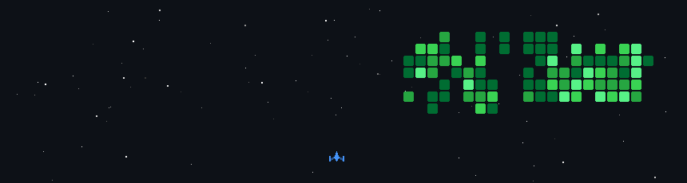

<!-- ================= HEADER ================= -->
<p align="center">
     
  
</p>

<p align="center">
  <a href="https://www.linkedin.com/in/rodrigo-achitzki-769050362/"></a>
  <a href="mailto:rodrigoachitzki@hotmail.com"></a>
  
</p>

---

### `> whoami`

```yaml
player: Rodrigo Achitzki
classe: Desenvolvedor Freelancer Full Stack
formacao: Análise e Desenvolvimento de Sistemas
guilda: Freelancer
especialidades:
  - sistemas industriais
  - SaaS industrial
  - automações com ESP32, Arduino e Raspberry Pi
  - dashboards e monitoramento em tempo real
status: "online — aceitando novas missões"
```

### 🗺️ Missão atual

- 🏭 Desenvolvendo **sistemas e SaaS para a indústria**
- 🔌 Criando **automações e IoT** com ESP32, Arduino e Raspberry Pi
- 📊 Construindo **dashboards** para monitorar produção e processos em tempo real
- 🌐 Projetos **full stack** sob medida para empresas
- 🤝 Aberto a novos projetos e parcerias

---

### 🎒 Inventário

<p align="center"><b>💻 Full Stack</b></p>
<p align="center">
  
</p>

<p align="center"><b>🔌 IoT & Automação</b></p>
<p align="center">
  
  <br/>
  
  
  
</p>

<p align="center"><b>🛠️ Ferramentas</b></p>
<p align="center">
  
</p>

---

### 📊 Player stats

<p align="center">
  
</p>

---

### 🚀 Contribuições

<p align="center">
  
</p>

<p align="center">
  
</p>
